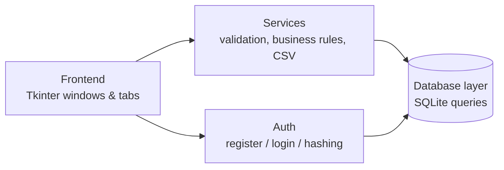

<div align="center">

# 💸 Finance Tracker

### A personal finance & budget tracker for students — built with Python, Tkinter and SQLite


Track daily income and expenses, set savings goals, and see where your money goes — all stored **locally** on your own computer.

</div>

---

## 📸 Screenshots

### Sign in & create account
<table>
  <tr>
    <td width="50%">
 alt="Login screen"/></td>
    <td width="50%"></td>
  </tr>
  <tr>
    <td align="center"><b>Login</b></td>
    <td align="center"><b>Create account</b></td>
  </tr>
</table>

### Dashboard & transactions


### Visual analytics


### Savings goals


---

## ✨ Features

| | Feature | Details |
|---|---|---|
| 🔐 | **User accounts** | Sign up / sign in. Every user sees only their own data. Passwords are salted and hashed with PBKDF2-SHA256. |
| 💳 | **Transactions (full CRUD)** | Add, view, edit and delete income and expenses with category, date and description. |
| 🔎 | **Filter & search** | Filter by month and type, or search by description / category. |
| 📊 | **Visual analytics** | Matplotlib charts embedded in the window: a spending-by-category donut chart and a yearly income-vs-expense bar chart. |
| 🎯 | **Savings goals** | Create goals, add savings towards them and track progress with a progress bar. |
| 📁 | **CSV export** | Export the currently filtered transactions to a `.csv` file that opens in Excel. |
| 📈 | **Live summary cards** | Total income, total expenses, balance, percentage of income spent and savings rate. |
| 🌙 | **Modern dark UI** | Custom-styled ttk theme with colour-coded cards and tabs. |

---

## 🧱 Tech stack

| Layer | Technology |
|---|---|
| Language | Python 3 |
| GUI | Tkinter / ttk (custom dark theme) |
| Database | SQLite (`sqlite3` from the standard library) |
| Charts | Matplotlib (embedded with `FigureCanvasTkAgg`) |
| Security | `hashlib.pbkdf2_hmac` with a random salt per user |
| Export | `csv` module (UTF-8 with BOM, so Excel shows ₹ correctly) |

---

## 🏗️ Architecture

The project is split into a **frontend** (what the user sees) and a **backend** (logic and data), so the UI never touches SQL directly.



```
Finance-Tracker/
├── main.py                        # Entry point: login → app → logout loop
├── requirements.txt               # Python dependencies (matplotlib)
├── backend/
│   ├── database.py                # SQLite schema + every SQL query (data layer)
│   ├── auth.py                    # Registration, login, password hashing
│   └── services.py                # Validation, business rules, CSV export
├── frontend/
│   ├── theme.py                   # Colours, fonts, ttk styles (dark theme)
│   ├── login_window.py            # Sign in / create account screen
│   ├── main_window.py             # Header, summary cards, period filter, tabs
│   ├── transactions_tab.py        # Add / edit / delete / search / export
│   ├── analytics_tab.py           # Embedded matplotlib charts
│   └── goals_tab.py               # Savings goals + progress
├── screenshots/                   # Images used in this README
└── data/
    └── finance.db                 # Created automatically on first run
```

### Database schema

| Table | Columns |
|---|---|
| `users` | `id`, `username` (unique, case-insensitive), `password_hash`, `created_at` |
| `categories` | `id`, `name`, `type` (`Income` / `Expense`) — unique per name + type |
| `transactions` | `id`, `user_id` → users, `type`, `amount` (> 0), `category_id` → categories, `description`, `date`, `created_at` |
| `goals` | `id`, `user_id` → users, `name`, `target` (> 0), `saved`, `deadline` |

All queries are **parameterised** (no string-built SQL) and every transaction / goal query is filtered by `user_id`.

---

## 🚀 Getting started

### Prerequisites
- **Python 3.10 or newer** — download from [python.org](https://www.python.org/downloads/)
  (the Windows installer already includes Tkinter; on Debian/Ubuntu run `sudo apt install python3-tk`)
- **pip** (comes with Python)

### 1. Get the code
```bash
git clone https://github.com/Om300607/Finance-Tracker.git
cd Finance-Tracker
```
Or click **Code → Download ZIP** on GitHub and extract it.

> Make sure your terminal is in the folder that contains `main.py`.

### 2. Install the dependency
```bash
pip install -r requirements.txt
```
On Windows you can also use `py -m pip install -r requirements.txt`.

### 3. Run the app
```bash
python main.py
```
(or `py main.py` on Windows)

---

## 📖 How to use

1. **Create an account** on the first launch (username: 3–20 letters, numbers or `_`; password: at least 6 characters).
2. *(Optional)* Open **File → Load sample data** to fill the app with three months of demo transactions and two goals — great for seeing the charts.
3. **Add a transaction:** choose *Income* or *Expense*, enter the amount, pick or type a category, set the date and click **Add Transaction**.
4. **Edit a transaction:** click a row in the table, change the form and click **Update Transaction**.
5. **Delete a transaction:** click a row, then **Delete Selected**.
6. **Filter:** use the **Period** drop-down at the top, the **Show** filter and the **Search** box.
7. **Analytics tab:** see spending by category and income vs expense for the year.
8. **Savings Goals tab:** create a goal, select it and click **Add Savings** to track progress.
9. **Export:** click **Export CSV** to save the transactions currently shown.
10. **Log out** with the button at the top right to switch accounts.

---

## 🔒 Security & privacy

- Passwords are **never stored in plain text** — each one is salted and hashed with PBKDF2-SHA256 (200,000 iterations).
- Every user's data is isolated by `user_id`; one account cannot read or change another's records.
- Everything is stored in a **local SQLite file** (`data/finance.db`). Nothing is sent over the internet.
- The database file is listed in `.gitignore`, so personal data is not uploaded to GitHub.

---

## 🛠️ Troubleshooting

| Problem | Fix |
|---|---|
| `No module named 'matplotlib'` | Run `pip install -r requirements.txt` |
| `No module named 'backend'` | You are in the wrong folder — `cd` into the one that contains `main.py` |
| `No module named 'tkinter'` (Linux) | `sudo apt install python3-tk` |
| `'python' is not recognized` (Windows) | Use `py main.py`, or reinstall Python and tick **Add Python to PATH** |
| Want a fresh start | Close the app and delete `data/finance.db` |

---

## 🔮 Future improvements

- Monthly budget limits per category with over-budget alerts
- Recurring transactions (rent, subscriptions)
- Password change and "forgot password" flow
- Import transactions from CSV
- Packaged Windows `.exe` release

---

## 👤 Author

**Om** — [GitHub @Om300607](https://github.com/Om300607)

Built as a college project to practise GUI development, database integration (CRUD), third-party library integration and clean project structure.

---

<div align="center">⭐ If you found this project useful, consider giving it a star!</div>
